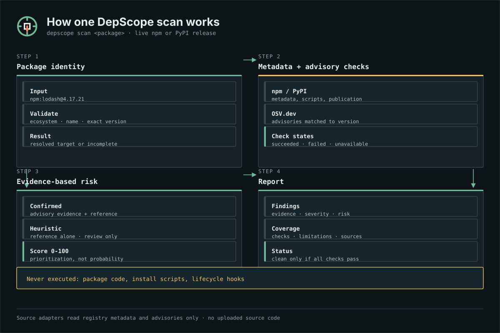
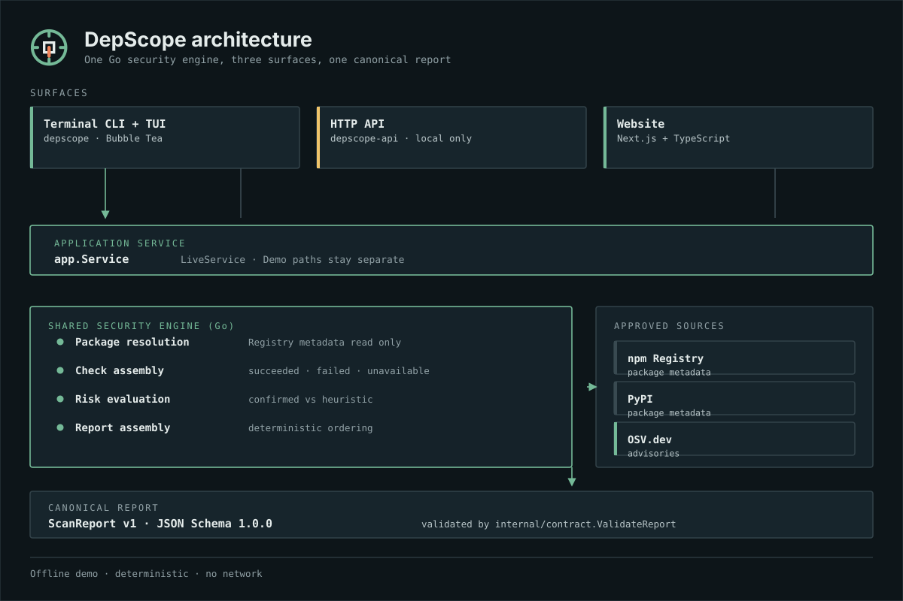

<p align="center">
  <picture>
    
  </picture>
</p>

<p align="center">
  <strong>A dependency security scanner for npm and PyPI that shows its evidence, its heuristics, and its blind spots.</strong>
</p>

<p align="center">
  <a href="README.zh-CN.md">简体中文</a> · <strong>English</strong> ·
  <a href="#quick-start">Quick start</a> ·
  <a href="#offline-demo">Offline demo</a> ·
  <a href="#security-model">Security model</a> ·
  <a href="#limitations">Limitations</a> ·
  <a href="docs/architecture.md">Architecture</a> ·
  <a href="CONTRIBUTING.md">Contributing</a>
</p>

---

DepScope answers one narrow question well: *what is known about this exact package release, and what was this scan unable to check?*

It scans npm and PyPI package releases through version-matched OSV.dev advisories, npm lifecycle-script declarations, and package-name similarity heuristics. Every report separates **confirmed vulnerabilities** from **heuristic review signals**, records the **status of every check**, and refuses to report `clean` when anything was skipped, unavailable, or failed.

DepScope reads package metadata and advisory data. It never installs, imports, or executes the packages it scans, and it never runs lifecycle scripts.

> **Project status:** the shared Go engine, Bubble Tea terminal app, non-interactive CLI, local HTTP API, and Next.js website are implemented and tested locally. The [latest release](https://github.com/janghotan/depscope/releases/latest) publishes CLI and API binaries for Linux, macOS, and Windows, but no hosted service is operated. See [Project status](#project-status).


*Real output of `depscope demo vulnerable`, captured offline. Package names, advisory IDs, and timestamps are synthetic demo data — not a live scan.*

## Why DepScope

Most dependency checks collapse into a single verdict. A missing advisory looks identical to a clean package, and heuristics get reported as if they were verified facts.

DepScope instead keeps three things visibly separate:

| Layer | What it means | Where it comes from |
| --- | --- | --- |
| **Confirmed findings** | A known advisory affects the resolved version | OSV.dev, matched to the exact version |
| **Heuristic warnings** | A reason to review, not proof of wrongdoing | npm lifecycle-script declarations, package-name similarity |
| **Coverage** | Which checks ran, failed, or could not run | Every report carries per-check status, sources, and limitations |

A scan that could not read OSV is not a scan that found nothing. DepScope reports it as `incomplete`.

## Features

- **Interactive terminal UI (Bubble Tea)** — menu-driven scans, comparisons, project scans, and global inventory, with real progress from the engine, cancellable scans, and keyboard-only navigation.
- **Single-package scans** — `npm` and `PyPI` releases, optionally pinned to an exact version, from the CLI or TUI.
- **Project dependency scans** — npm `package.json` + `package-lock.json` (lockfile version 2 or 3) resolved through the lockfile graph, and Python `requirements.txt` with exact `==`/`===` pins. Each finding includes evidence-backed dependency context: direct or transitive, production/development/optional/unknown, a bounded path from the project root, the manifest or lockfile field used, and whether resolution was complete or partial.
- **Global inventory** — read-only listing of top-level global npm packages and the selected Python interpreter's pip environment, with an overview that separates installed packages, affected packages, and advisory matches.
- **Comparison** — scan two packages side by side with independent side failures preserved.
- **Local HTTP API** — `GET /healthz`, `POST /api/v1/scan`, and `POST /api/v1/compare`, returning canonical `ScanReport` v1 values validated before they leave the process.
- **Website** — Next.js app for single scans, two-package comparison, and offline demo records that make no API requests.
- **Offline demo** — deterministic, network-free scenarios that run entirely through the shared engine, clearly labelled on every surface.
- **Shared report contract** — one JSON Schema (`schemas/scan-report.v1.schema.json`) drives Go validation and generated TypeScript types, so the terminal, API, and website interpret status the same way.

## Requirements

| Component | Requirement |
| --- | --- |
| Prebuilt CLI | Linux, macOS, or Windows on `amd64` or `arm64`; `curl`, `tar`, and `sha256sum`/`shasum` on Unix |
| Go CLI / API (source builds) | Go 1.26.10 or later (matching `go.mod`) |
| Website | Node.js 24.22.0 (`.nvmrc`) and pnpm 12.14.0 |
| Live scans | Outbound HTTPS to the npm Registry, PyPI, and OSV.dev |
| Browser tests | Playwright-managed Chromium |

## Install

The installer downloads the latest published DepScope CLI release, verifies its SHA-256 checksum against the release's `checksums.txt`, and installs the `depscope` binary for the current user. It does not require root or administrator privileges.

### Linux and macOS

```sh
curl -fsSL https://raw.githubusercontent.com/janghotan/depscope/main/install.sh | sh
```

### Windows (PowerShell)

```powershell
irm https://raw.githubusercontent.com/janghotan/depscope/main/install.ps1 | iex
```

Both installers accept an explicit version and an installation directory:

```sh
# Unix: pin a release and choose the directory
curl -fsSL https://raw.githubusercontent.com/janghotan/depscope/main/install.sh | sh -s -- --version v0.1.1 --dir "$HOME/bin"
```

```powershell
# Windows: pin a release and choose the directory
& ([scriptblock]::Create((irm https://raw.githubusercontent.com/janghotan/depscope/main/install.ps1))) -Version v0.1.1 -InstallDir "$HOME\bin"
```

| Setting | Unix | Windows |
| --- | --- | --- |
| Default install directory | `$HOME/.local/bin` | `%LOCALAPPDATA%\Programs\DepScope\bin` |
| Directory override | `--dir <path>` or `DEPSCOPE_INSTALL_DIR` | `-InstallDir <path>` or `DEPSCOPE_INSTALL_DIR` |
| Version override | `--version <tag>` or `DEPSCOPE_VERSION` | `-Version <tag>` or `DEPSCOPE_VERSION` |
| Requires elevation | No | No |

### What the installers verify

- Plain HTTP is refused; downloads use HTTPS with normal certificate validation.
- `checksums.txt` is downloaded first, and the selected archive must be listed in it. A release without a build for your platform fails instead of installing something else.
- The archive's SHA-256 is compared **before** anything is extracted or executed. A mismatch aborts the install and leaves nothing behind.
- Only the `depscope` binary is installed. The separate `depscope-api` archive is never installed by these scripts.
- An existing `depscope` binary is replaced only after the new one has been downloaded, verified, and staged in the target directory. The install prints where the binary went and whether that directory is on your `PATH`.
- Temporary files are created under the system temporary directory and removed on exit.

`checksums.txt` protects against corrupted or mismatched downloads from the same host. The checksums are **not** cryptographically signed, so they do not by themselves prove the release was authored by the maintainer.

### PATH setup

If the install directory is not on your `PATH`, the installer prints the line to add. For the default Unix directory, add this to your shell profile (`~/.profile`, `~/.zshrc`, or `~/.bashrc`):

```sh
export PATH="$HOME/.local/bin:$PATH"
```

On Windows, add the directory to your user `PATH` and open a new terminal:

```powershell
[Environment]::SetEnvironmentVariable('Path', [Environment]::GetEnvironmentVariable('Path','User') + ";$([Environment]::GetFolderPath('LocalApplicationData'))\Programs\DepScope\bin", 'User')
```

### Uninstall

```sh
# Unix
rm -f "$HOME/.local/bin/depscope"
```

```powershell
# Windows
Remove-Item "$env:LOCALAPPDATA\Programs\DepScope" -Recurse -Force
```

The offline demo (`depscope demo`) needs no network and works immediately after installation.

### Release formats

Each release publishes separate CLI and API archives: `depscope_cli_<version>_<os>_<arch>.tar.gz` for Linux and macOS, `depscope_cli_<version>_<os>_<arch>.zip` for Windows, plus `checksums.txt` containing SHA-256 checksums. Verify a manual download before extracting:

```sh
sha256sum --check checksums.txt --ignore-missing
```

On macOS use `shasum -a 256 --check checksums.txt`; on Windows PowerShell compare `(Get-FileHash .\depscope_*.zip -Algorithm SHA256).Hash` with the matching `checksums.txt` entry. Release contents and the gated publishing procedure are documented in [release engineering](docs/release.md).

## Build from source

Building from source is the path for development and for platforms without a prebuilt binary. End users should use the installer above.

Install Go 1.26.10 or later, check out this repository, then build:

```sh
go build -trimpath -o bin/depscope ./cmd/depscope
go build -trimpath -o bin/depscope-api ./cmd/depscope-api
```

Verify the build:

```sh
./bin/depscope version
./bin/depscope help
```

The verified release matrix targets Linux, macOS, and Windows on `amd64` and `arm64`; CI cross-compiles each target. Cross-compilation proves the binaries build — it is not runtime testing on every platform.

### Run without building

```sh
go run ./cmd/depscope help
go run ./cmd/depscope-api
```

## Quick start

After [installing](#install), the `depscope` command is on your `PATH`. From a source checkout, use `go run ./cmd/depscope` instead of `depscope`, or build the binary first with `go build -trimpath -o bin/depscope ./cmd/depscope` and run `./bin/depscope`.

```sh
# Scan one npm release (contacts the npm Registry and OSV.dev)
depscope scan lodash@4.17.21

# Scan a PyPI release with an exact version
depscope scan pypi:requests==2.31.0

# Scan the current project's supported manifest and lockfile
depscope project

# Compare two packages side by side
depscope compare lodash@4.17.21 minimist@1.2.5

# Open the interactive terminal app
depscope
```

Package syntax:

| Form | Example | Meaning |
| --- | --- | --- |
| npm, latest | `lodash` | Resolve the latest npm release |
| npm, exact version | `lodash@4.17.21` | Scan that exact npm release |
| scoped npm | `@scope/package@1.0.0` | Scoped npm package |
| PyPI, latest | `pypi:requests` | Resolve the latest PyPI release |
| PyPI, exact version | `pypi:requests==2.31.0` | Scan that exact PyPI release |
| explicit ecosystem | `npm:lodash` | Force the npm ecosystem |

Version ranges, URLs, paths, and expressions are rejected rather than approximated. Omitting the version asks the source for the latest published release.

All commands and exit codes:

| Command | Purpose |
| --- | --- |
| `depscope` | Open the interactive terminal app |
| `depscope scan <package>` | Scan one npm or PyPI package |
| `depscope project [path]` | Scan a project directory (default: `.`) |
| `depscope compare <left> <right>` | Compare two packages side by side |
| `depscope inventory` | List global npm and Python packages |
| `depscope demo [scenario]` | Run an offline deterministic demo |
| `depscope demo list` | List demo scenarios |
| `depscope help` | Show usage |
| `depscope version` | Show the version |

Global flags go before the command: `--no-color`, `--color=auto|always|never`, `--help`, and `--version`. Without a terminal, `depscope` prints help instead of starting the interactive app.

The interactive app animates a short brand reveal, navigation feedback, a loading indicator, and a completion transition. Animations are disabled by `DEPSCOPE_NO_ANIMATION=1`, by `TERM=dumb`, and in CI environments; every screen stays fully usable with animation and color disabled. `NO_COLOR` disables color only and never affects navigation.

The interactive app can display English or Simplified Chinese. Open **Settings** from the main menu, select **Language**, and press `enter` or `left`/`right` to switch immediately. The choice is session-only: it is never written to disk, and a new session starts in English. Menus, forms, help, loading states, reports, and comparisons are localized, while package names, versions, advisory IDs, URLs, and raw advisory text stay unchanged. Layout, wrapping, and input focus use terminal display cells, so Chinese text aligns and wraps correctly. The non-interactive CLI, HTTP API, and website remain English.

The terminal interface pairs each workflow, report status, severity, and check outcome with a semantic icon and text. Icons are measured in display cells, never convey meaning alone, and do not require a Nerd Font. `DEPSCOPE_NO_ICONS=1` hides them without changing labels or values; `DEPSCOPE_ASCII_ICONS=1`, `TERM=dumb`, or a non-UTF-8 locale switches to ASCII symbols. The shield logo, `DEPSCOPE` wordmark, and spinner behavior are unchanged, and non-interactive CLI output remains icon-free.

| Exit code | Meaning |
| --- | --- |
| `0` | Command completed; report status was not `failed` or `cancelled` (an `incomplete` report still exits `0`) |
| `1` | Operational failure, including a `failed` or `cancelled` scan |
| `2` | Usage error: unknown command or flag, missing argument, or unknown demo scenario |
| `130` | Interactive app interrupted with `ctrl+c` |

## Offline demo

The demo makes **no network requests** and uses deterministic synthetic data:

```sh
go run ./cmd/depscope demo list
go run ./cmd/depscope demo vulnerable      # confirmed critical + medium advisories
go run ./cmd/depscope demo install-scripts # lifecycle-script heuristic + deprecation context
go run ./cmd/depscope demo clean           # all checks succeeded, no findings
```

Demo output is stable across runs: fixed timestamps, `DEMO-` identifiers, `depscope-demo` package names, `provider: "demo"` sources, and a non-empty demo notice. The website's demo records are separate validated fixtures and make no scan or comparison API requests.

### Example output

The excerpt below is from the `vulnerable` **demo fixture**; it is demonstration output, not a live scan result:

```text
PACKAGE REPORT
npm:@depscope-demo/vulnerable-package
Resolved version 2.0.0

  Data mode            DEMO
  Scanned at           2026-01-01T00:00:00Z
  Sources              3 recorded

[DEMO DATA] DEMO DATA: Deterministic synthetic results. No network requests were made; this is not a
            real security assessment.

ASSESSMENT
  Status               [FINDINGS]
  Completed checks     6 of 6 succeeded
  Confirmed findings   2
  Heuristic warnings   0
  Highest severity     [CRITICAL]
```

Run `go run ./cmd/depscope demo vulnerable` for the complete synthetic report.

## How a scan works



1. **Package identity** — the ecosystem, canonical name, and optional exact version are validated before any request.
2. **Metadata and advisory checks** — the npm Registry or PyPI returns release metadata, and OSV.dev is queried with the resolved version. Each check records a status: `succeeded`, `failed`, `unavailable`, or `skipped`.
3. **Evidence-based risk** — confirmed findings require advisory evidence with a reference; heuristics are separate and never presented as proof. Risk scores from 0 to 100 are prioritization values, not probabilities.
4. **Report** — findings, evidence, checks, sources, limitations, and a final status are assembled deterministically and validated against the canonical schema.

## Confirmed findings vs. heuristic warnings

| | Confirmed finding | Heuristic warning |
| --- | --- | --- |
| **Basis** | Resolved version matched to an OSV.dev advisory with a reference | A declared npm lifecycle script, or a close package-name match |
| **Meaning** | A known advisory affects this version | A reason to review — not evidence of malicious behavior |
| **Severity** | Normalized from advisory metadata and CVSS where available | Fixed per rule (`low` for lifecycle scripts, `medium` for name similarity) |
| **Score band** | 35–95 | 15–50 |
| **Never** | Suppressed because a package looks popular or maintained | Presented as proof of compromise |

A heuristic critical signal (50) never outranks a confirmed high finding (80). Unknown severity stays unknown — it is never converted into `clean` or `low`. Full rules: [risk and evidence rules](docs/risk-rules.md).

## Risk model overview

| Status | Meaning |
| --- | --- |
| `clean` | Every check succeeded, no findings exist, and at least one source is recorded |
| `findings` | The scan completed and produced confirmed findings and/or heuristic warnings |
| `incomplete` | At least one check failed, was unavailable, or was skipped; findings found so far are still reported |
| `failed` | The scan could not establish package identity or resolve a version |
| `cancelled` | The scan was cancelled before a result was available |

Severity levels: `critical`, `high`, `medium`, `low`, `unknown`. Findings are ordered confirmed-first, then by severity, then by ID. Source and evidence limitations are recorded in the report rather than discarded.

### Data sources

| Source | Used for | Terms |
| --- | --- | --- |
| [npm Registry](https://registry.npmjs.org/) | Package metadata, lifecycle-script declarations, publication data | See the npm public registry documentation |
| [PyPI](https://pypi.org/) | Package metadata and release information | See the PyPI terms of use and JSON API documentation |
| [OSV.dev](https://osv.dev/) | Version-matched vulnerability advisories | See the OSV.dev usage documentation |

DepScope uses these public services only for package metadata and advisories. It does not upload your source code, file contents, or project paths.

## Security model: what a clean scan does and does not mean

**A `clean` result is not a guarantee that a package is safe.** It means every check DepScope performed came back successfully and produced no findings.

A scan can be incomplete because:

- a registry or advisory source was unreachable, rate limited, or returned malformed data;
- the requested version could not be resolved from the supported input;
- Python transitive dependencies were not resolved (direct pins only);
- npm workspaces, peer dependencies, or unsupported lockfile versions were present;
- a check was skipped for this target.

In each case the report is `incomplete` (or `failed`), and the reason is listed in the report's checks and limitations. DepScope never substitutes the latest version for an unresolved one and never falls back from a failed live scan to demo data.

DepScope does **not** provide:

- comprehensive malware detection;
- maintainer account-takeover detection;
- exploitability analysis or proof-of-concept validation;
- code-reachability analysis — dependency context shows how a package enters a project, not whether vulnerable code is reachable;
- package code inspection — it never downloads or executes the packages it scans;
- popularity or download-count data.

## Supported ecosystems

| Ecosystem | Single release | Project scan | Global inventory |
| --- | --- | --- | --- |
| **npm** | Any published release | `package.json` + `package-lock.json` lockfile v2/v3 graph | Top-level global packages |
| **PyPI** | Any published release | `requirements.txt` with exact `==`/`===` pins only | Selected interpreter's default pip environment |

Known format limitations:

- npm workspaces, peer-dependency resolution, and lockfile versions other than 2 and 3 are not supported.
- Python transitive resolution, Python lockfiles (`poetry.lock`, `Pipfile.lock`, `uv.lock`, `pdm.lock`), `pyproject.toml`, `Pipfile`, `setup.py`, `setup.cfg`, ranges, wildcards, unpinned, URL, editable, and marker-dependent requirements are not supported. These files are detected and reported as unsupported input.
- Global inventory is read-only and covers top-level npm packages and one pip environment only; nested and symlinked npm entries are not scanned.
- npm and PyPI are the only supported ecosystems.

Unsupported or unresolved input is reported as `incomplete` — never approximated with the latest version.

Dependency context comes only from supported metadata. npm scopes use manifest sections and lockfile `dev`/`optional` flags; `requirements.txt` has no scope metadata, so Python scope is reported as `unknown` and its resolution as `partial`. Context never changes advisory severity, finding identity, or risk, and it does not imply exploitability or code reachability.

## Architecture



```text
CLI / TUI ─┐
           ├── Go application service ── shared scan engine ── npm / PyPI / OSV
HTTP API ──┘                                  │
                                              └── canonical ScanReport v1
                                                       │
Website ── same-origin server proxy ──────────────────┘
```

The Go engine owns package resolution, source matching, risk evaluation, and report assembly. The CLI/TUI and HTTP API are adapters over the same `app.Service`; the website consumes the canonical schema and generated types through same-origin server routes. Demo mode uses a separate deterministic engine path and cannot be reached from a live scan.

Further reading: [architecture](docs/architecture.md), [data contracts](docs/contracts.md), [risk rules](docs/risk-rules.md), [API reference](docs/api.md), [schema rules](schemas/README.md), [release engineering](docs/release.md).

## HTTP API

The API is a **local, unauthenticated** service intended for loopback use or a separately secured network boundary. It has no persistence, accounts, telemetry, or TLS termination.

```sh
go build -o depscope-api ./cmd/depscope-api
./depscope-api
```

```sh
curl -sS http://127.0.0.1:8080/healthz
```

```sh
curl -sS http://127.0.0.1:8080/api/v1/scan \
  -H 'Content-Type: application/json' \
  -d '{"ecosystem":"npm","name":"lodash","version":"4.17.21"}'
```

| Endpoint | Purpose |
| --- | --- |
| `GET /healthz` | Process liveness only; does not contact npm, PyPI, or OSV |
| `POST /api/v1/scan` | One live package report, validated against schema v1 |
| `POST /api/v1/compare` | Comparison envelope with independent side failures |

A successful HTTP request returns `200` even when the embedded report status is `findings`, `incomplete`, or `failed`; those are report states, not transport errors. Request validation, the error envelope, and configuration variables (`DEPSCOPE_API_ADDR`, `DEPSCOPE_API_REQUEST_TIMEOUT`, `DEPSCOPE_API_MAX_BODY_BYTES`, `DEPSCOPE_API_MAX_CONCURRENCY`, `DEPSCOPE_API_RATE_PER_MINUTE`, `DEPSCOPE_API_RATE_BURST`, `DEPSCOPE_API_CORS_ORIGINS`, `DEPSCOPE_API_SHUTDOWN_TIMEOUT`) are documented in the [API reference](docs/api.md).

The API serves live scans only. It does not expose demo data, project scans, or inventory results.

## Website

The website lives in `web/` and uses Next.js App Router, TypeScript, and Tailwind CSS. It proxies live scans through same-origin server routes, validates canonical reports, and keeps demo fixtures isolated from live mode. It does not call npm, PyPI, or OSV directly.

```sh
# Terminal 1: the Go API
go run ./cmd/depscope-api

# Terminal 2: the website
cd web
pnpm install --frozen-lockfile
cp .env.example .env.local
pnpm dev
```

Open <http://localhost:3000>. Server-side configuration:

| Variable | Default | Purpose |
| --- | --- | --- |
| `DEPSCOPE_API_BASE_URL` | `http://127.0.0.1:8080` | Go API base URL used by server routes |
| `DEPSCOPE_API_TIMEOUT_MS` | `100000` | Upstream request timeout in milliseconds |
| `DEPSCOPE_SITE_URL` | `http://localhost:3000` | Canonical site URL for metadata and sharing |
| `DEPSCOPE_REPOSITORY_URL` | unset | Optional source-repository link in the footer; unset hides the link |

The offline web demo works without the API. Details: [website README](web/README.md).

## Local development

Run the complete Go checks from the repository root:

```sh
gofmt -l .              # must print nothing
go vet ./...
go build -trimpath ./...
go test -count=1 ./...
go mod verify
```

Optional deeper checks:

```sh
go test -race -count=1 ./...
go run golang.org/x/vuln/cmd/govulncheck@v1.9.0 ./...
go test -tags live -run '^$' ./internal/live/   # compile live-tagged tests without contacting the network
```

Run the website checks:

```sh
cd web
pnpm install --frozen-lockfile
pnpm check:contract
pnpm lint
pnpm typegen
pnpm typecheck
pnpm test
pnpm build
pnpm exec playwright install chromium
pnpm test:e2e
pnpm audit --prod --audit-level high
```

The default test suite never contacts public package or vulnerability services. Live smoke tests are opt-in behind a build tag and environment variable:

```sh
DEPSCOPE_LIVE_TESTS=1 go test -tags live -run TestLiveSmokeNPM ./internal/live/
```

## Project status

| Area | Status |
| --- | --- |
| Go engine, CLI, TUI, offline demo | Implemented and covered by tests |
| TUI languages | English and Simplified Chinese, selected in Settings; session-only. CLI, API, and website remain English |
| TUI icons | Semantic glyphs paired with text; ASCII and icon-free modes. CLI output remains icon-free |
| Local HTTP API | Implemented; local, unauthenticated, process-local limits |
| Website (single scan, comparison, demo records) | Implemented locally; not deployed |
| CI and GoReleaser configuration | CI and the release workflow run on GitHub; tagged releases publish CLI and API archives with a SHA-256 `checksums.txt` (not signed) |
| Hosted API or hosted website | Not provided |
| License | Apache License 2.0; copyright 2026 Jangho Tan |
| Recursive Python resolution, more lockfiles, CLI JSON output, project/inventory API serialization | Not implemented |

See [implementation plan](docs/implementation-plan.md) for phase history and [architecture decisions](docs/architecture.md) for open items.

## Contributing

Contributions are welcome. Start with [CONTRIBUTING.md](CONTRIBUTING.md), then read [architecture](docs/architecture.md) and [risk rules](docs/risk-rules.md) before changing behavior.

- Add deterministic tests with synthetic fixtures; the default suite must not make public network requests.
- Preserve incomplete results and evidence — a missing check must never become a clean result.
- Never install, import, or execute scanned packages or run their lifecycle scripts.
- All new source-code comments and docstrings are written in Simplified Chinese; identifiers, CLI/API output, and public documentation stay in English, while interactive TUI copy is localized through `internal/i18n`.
- Describe the exact commands you ran in your pull request.

## Security

Please do not open a public issue for a vulnerability in DepScope itself. Use GitHub private vulnerability reporting through the **Security** tab, or read [SECURITY.md](SECURITY.md) for the current reporting path.

Do not include secrets, private source code, or personal data in any report.

Reporting a *dependency* problem found with DepScope belongs in that package's own advisory channel, not in this repository.

## License

Distributed under the [Apache License 2.0](LICENSE). Third-party components and their licenses are listed in [NOTICE](NOTICE).

Copyright 2026 Jangho Tan, as recorded in `LICENSE` and `NOTICE`. The only difference from the official Apache 2.0 text published at <https://www.apache.org/licenses/LICENSE-2.0.txt> is that copyright line; the license terms are unmodified. Naming the copyright holder records the maintainer's chosen attribution and does not by itself establish, transfer, or determine anyone's legal rights beyond the Apache License 2.0 grant.

## Try it, report it, improve it

```sh
go run ./cmd/depscope demo vulnerable
go run ./cmd/depscope scan lodash@4.17.21
```

If DepScope shows you something your other tools missed — or misses something you think it should see — that is worth an issue. Bug reports, unsupported-format reports, and clearer explanations for findings are all welcome.
