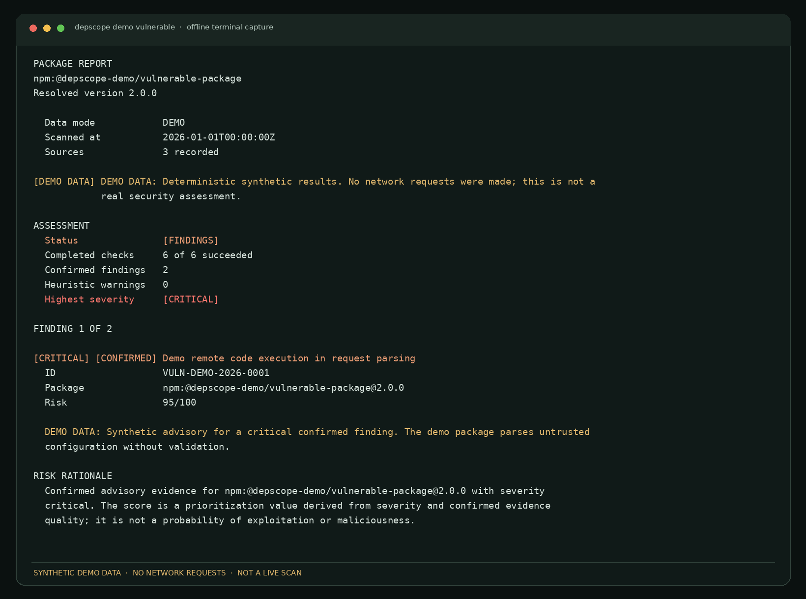
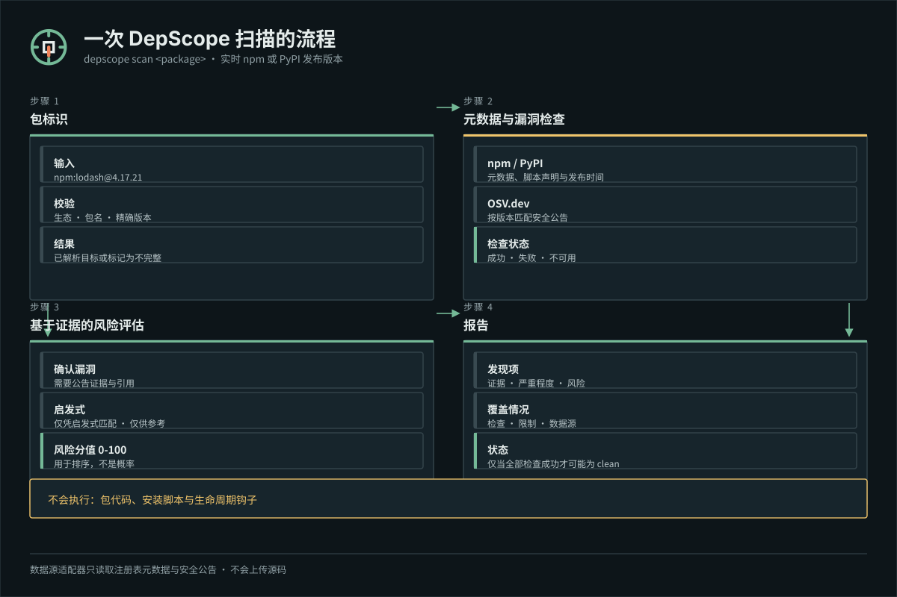
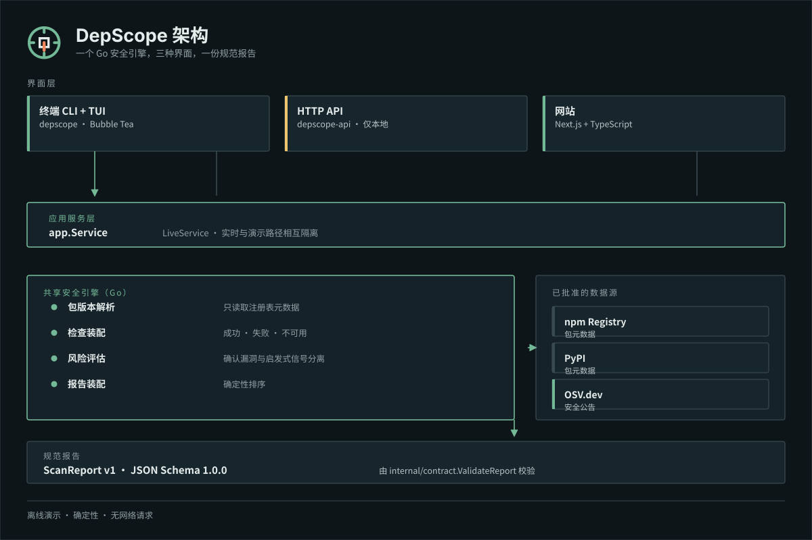

<p align="center">
  <picture>
    
  </picture>
</p>

<p align="center">
  <strong>面向 npm 与 PyPI 的依赖安全扫描器：给出证据，也给出启发式信号与检查盲区。</strong>
</p>

<p align="center">
  <strong>简体中文</strong> · <a href="README.md">English</a> ·
  <a href="#快速开始">快速开始</a> ·
  <a href="#离线演示">离线演示</a> ·
  <a href="#安全模型">安全模型</a> ·
  <a href="#支持范围与已知限制">已知限制</a> ·
  <a href="docs/architecture.md">架构文档</a> ·
  <a href="CONTRIBUTING.md">参与贡献</a>
</p>

---

DepScope 专注于回答一个范围明确的问题：*这个确切的包版本有什么已知情况，以及本次扫描有哪些内容没能检查？*

它通过按版本匹配的 OSV.dev 安全公告、npm 生命周期脚本声明和包名相似度启发式规则，扫描 npm 与 PyPI 的发布版本。每份报告都会把**已确认漏洞**与**启发式审查信号**分开，记录**每一项检查的状态**，并且在任何检查被跳过、不可用或失败时拒绝给出 `clean` 结论。

DepScope 只读取包的元数据与安全公告，从不安装、导入或执行所扫描的包，也从不运行生命周期脚本。

> **项目状态：** 共享 Go 引擎、Bubble Tea 终端应用、非交互式 CLI、本地 HTTP API 与 Next.js 网站均已实现并在本地测试通过。[最新版本](https://github.com/janghotan/depscope/releases/latest)提供 Linux、macOS 与 Windows 的 CLI 与 API 二进制，但目前不提供任何托管服务。详见[项目状态](#项目状态)。



*`depscope demo vulnerable` 的真实输出，离线生成。包名、公告编号与时间戳均为合成演示数据，并非实时扫描结果。*

## 为什么选择 DepScope

多数依赖检查最终只给出一个结论。数据源缺失看起来与包本身干净毫无区别，启发式信号也常被当作已核实的事实呈现。

DepScope 把下面三类信息始终保持可见的区分：

| 层次 | 含义 | 来源 |
| --- | --- | --- |
| **已确认发现** | 存在影响该版本的安全公告 | OSV.dev，按精确版本匹配 |
| **启发式警告** | 值得审查的理由，并非恶意行为的证据 | npm 生命周期脚本声明、包名相似度 |
| **覆盖情况** | 哪些检查执行了、失败了或无法执行 | 每份报告都带有逐项检查状态、数据源与限制说明 |

无法访问 OSV 的扫描，并不等于没有发现任何问题的扫描。DepScope 会把它报告为 `incomplete`。

## 功能特性

- **交互式终端界面（Bubble Tea）**——菜单式扫描、比较、项目扫描与全局清单，进度来自引擎的真实工作，扫描可随时取消，支持纯键盘操作。
- **单包扫描**——在 CLI 或 TUI 中扫描 `npm` 与 `PyPI` 发布版本，可指定精确版本。
- **项目依赖扫描**——依据 `package-lock.json`（lockfile 版本 2 或 3）依赖图解析 npm `package.json`；Python 支持精确 `==`/`===` 锁定的 `requirements.txt`。
- **全局清单**——只读列出全局安装的顶层 npm 包，以及所选 Python 解释器的 pip 环境；概览分别给出已安装包数、受影响包数与漏洞匹配数。
- **包比较**——并排扫描两个包，并保留各自独立的失败信息。
- **本地 HTTP API**——`GET /healthz`、`POST /api/v1/scan` 与 `POST /api/v1/compare`，返回响应前会校验规范 `ScanReport` v1。
- **网站**——基于 Next.js，支持单包扫描、双包比较，以及完全离线、不发起扫描请求的演示记录。
- **离线演示**——确定性、无网络访问的演示场景，全部经由共享引擎生成，并在每个界面上明确标注。
- **共享报告契约**——以同一份 JSON Schema（`schemas/scan-report.v1.schema.json`）驱动 Go 校验与 TypeScript 类型生成，确保终端、API 与网站对状态的理解完全一致。

## 环境要求

| 组件 | 要求 |
| --- | --- |
| 预编译 CLI | Linux、macOS 或 Windows，架构为 `amd64` 或 `arm64`；Unix 上需要 `curl`、`tar` 与 `sha256sum`/`shasum` |
| Go CLI / API（源码构建） | Go 1.26.10 或更高版本（与 `go.mod` 一致） |
| 网站 | Node.js 24.22.0（见 `.nvmrc`）与 pnpm 12.14.0 |
| 实时扫描 | 可访问 npm Registry、PyPI 与 OSV.dev 的 HTTPS 出站网络 |
| 浏览器测试 | 由 Playwright 管理的 Chromium |

## 安装

安装脚本会下载最新发布的 DepScope CLI 版本，用发布附带的 `checksums.txt` 校验其 SHA-256 摘要，然后把 `depscope` 可执行文件安装到当前用户目录。整个过程不需要 root 或管理员权限。

### Linux 与 macOS

```sh
curl -fsSL https://raw.githubusercontent.com/janghotan/depscope/main/install.sh | sh
```

### Windows（PowerShell）

```powershell
irm https://raw.githubusercontent.com/janghotan/depscope/main/install.ps1 | iex
```

两个安装脚本都支持指定版本与安装目录：

```sh
# Unix：固定版本并指定目录
curl -fsSL https://raw.githubusercontent.com/janghotan/depscope/main/install.sh | sh -s -- --version v0.1.1 --dir "$HOME/bin"
```

```powershell
# Windows：固定版本并指定目录
& ([scriptblock]::Create((irm https://raw.githubusercontent.com/janghotan/depscope/main/install.ps1))) -Version v0.1.1 -InstallDir "$HOME\bin"
```

| 配置项 | Unix | Windows |
| --- | --- | --- |
| 默认安装目录 | `$HOME/.local/bin` | `%LOCALAPPDATA%\Programs\DepScope\bin` |
| 目录覆盖方式 | `--dir <path>` 或 `DEPSCOPE_INSTALL_DIR` | `-InstallDir <path>` 或 `DEPSCOPE_INSTALL_DIR` |
| 版本覆盖方式 | `--version <tag>` 或 `DEPSCOPE_VERSION` | `-Version <tag>` 或 `DEPSCOPE_VERSION` |
| 是否需要提权 | 否 | 否 |

### 安装脚本会做什么校验

- 拒绝明文 HTTP；下载一律使用 HTTPS 并执行常规证书校验。
- 先下载 `checksums.txt`，所选归档必须登记在其中。如果某个版本没有为你的平台构建，安装会直接失败，而不会改装修其他文件。
- 只有在**解压或执行之前**完成归档的 SHA-256 比对。校验失败即中止安装，不留下任何文件。
- 只安装 `depscope` 可执行文件。独立的 `depscope-api` 归档不会被这些脚本安装。
- 只有当新版本已下载、校验并暂存到目标目录之后，才会替换已有的 `depscope`。安装结束会打印安装路径，并说明该目录是否在 `PATH` 中。
- 临时文件建立在系统临时目录下，并在退出时删除。

`checksums.txt` 只能防止同一来源的下载被损坏或错配。这些校验值**没有**做加密签名，因此它本身不能证明发布内容出自维护者。

### 配置 PATH

如果安装目录不在 `PATH` 中，脚本会打印需要添加的那一行。以 Unix 默认目录为例，把它加入 shell 配置文件（`~/.profile`、`~/.zshrc` 或 `~/.bashrc`）：

```sh
export PATH="$HOME/.local/bin:$PATH"
```

Windows 上把目录加入当前用户的 `PATH`，然后打开新的终端：

```powershell
[Environment]::SetEnvironmentVariable('Path', [Environment]::GetEnvironmentVariable('Path','User') + ";$([Environment]::GetFolderPath('LocalApplicationData'))\Programs\DepScope\bin", 'User')
```

### 卸载

```sh
# Unix
rm -f "$HOME/.local/bin/depscope"
```

```powershell
# Windows
Remove-Item "$env:LOCALAPPDATA\Programs\DepScope" -Recurse -Force
```

离线演示（`depscope demo`）无需网络，安装后即可使用。

### 发布格式

每个版本都会发布独立的 CLI 与 API 归档：Linux 与 macOS 使用 `depscope_cli_<version>_<os>_<arch>.tar.gz`，Windows 使用 `depscope_cli_<version>_<os>_<arch>.zip`，并附带包含 SHA-256 校验值的 `checksums.txt`。手动下载后请先校验再解压：

```sh
sha256sum --check checksums.txt --ignore-missing
```

macOS 上使用 `shasum -a 256 --check checksums.txt`；Windows PowerShell 中用 `(Get-FileHash .\depscope_*.zip -Algorithm SHA256).Hash` 与 `checksums.txt` 中对应条目比对。归档内容与受控的发布流程见[发布工程说明](docs/release.md)。

## 从源码构建

从源码构建适用于开发场景，以及没有预编译二进制的平台。终端用户请使用上面的安装方式。

安装 Go 1.26.10 或更高版本，检出本仓库后执行：

```sh
go build -trimpath -o bin/depscope ./cmd/depscope
go build -trimpath -o bin/depscope-api ./cmd/depscope-api
```

验证构建结果：

```sh
./bin/depscope version
./bin/depscope help
```

已验证的发布矩阵覆盖 Linux、macOS 与 Windows 的 `amd64` 与 `arm64`；CI 会对每个目标进行交叉编译。交叉编译只能证明二进制可以构建，并不等于在每个平台上都完成了运行时测试。

### 无需构建即可运行

```sh
go run ./cmd/depscope help
go run ./cmd/depscope-api
```

## 快速开始

完成[安装](#安装)后，`depscope` 命令已经在 `PATH` 中。在源码检出中，用 `go run ./cmd/depscope` 代替 `depscope`，或先执行 `go build -trimpath -o bin/depscope ./cmd/depscope` 再运行 `./bin/depscope`。

```sh
# 扫描一个 npm 发布版本（会访问 npm Registry 与 OSV.dev）
depscope scan lodash@4.17.21

# 以精确版本扫描一个 PyPI 发布版本
depscope scan pypi:requests==2.31.0

# 扫描当前项目受支持的清单与锁文件
depscope project

# 并排比较两个包
depscope compare lodash@4.17.21 minimist@1.2.5

# 打开交互式终端应用
depscope
```

包语法：

| 写法 | 示例 | 含义 |
| --- | --- | --- |
| npm，最新版本 | `lodash` | 解析 npm 的最新发布版本 |
| npm，精确版本 | `lodash@4.17.21` | 扫描该确切的 npm 发布版本 |
| 作用域 npm 包 | `@scope/package@1.0.0` | 作用域 npm 包 |
| PyPI，最新版本 | `pypi:requests` | 解析 PyPI 的最新发布版本 |
| PyPI，精确版本 | `pypi:requests==2.31.0` | 扫描该确切的 PyPI 发布版本 |
| 显式指定生态 | `npm:lodash` | 强制使用 npm 生态 |

版本范围、URL、路径与表达式会被拒绝，而不会被近似处理。省略版本时，将向数据源请求最新的已发布版本。

全部命令与退出码：

| 命令 | 用途 |
| --- | --- |
| `depscope` | 打开交互式终端应用 |
| `depscope scan <package>` | 扫描单个 npm 或 PyPI 包 |
| `depscope project [path]` | 扫描项目目录（默认 `.`） |
| `depscope compare <left> <right>` | 并排比较两个包 |
| `depscope inventory` | 列出全局 npm 与 Python 包 |
| `depscope demo [scenario]` | 运行离线确定性演示 |
| `depscope demo list` | 列出演示场景 |
| `depscope help` | 显示用法 |
| `depscope version` | 显示版本 |

全局参数需写在命令之前：`--no-color`、`--color=auto|always|never`、`--help` 与 `--version`。没有终端时，`depscope` 会打印帮助信息，而不会启动交互式应用。

交互式应用包含短暂的品牌入场、导航反馈、加载指示与完成过渡动画。设置 `DEPSCOPE_NO_ANIMATION=1`、`TERM=dumb` 或在 CI 环境中运行时，动画会自动关闭；关闭动画与颜色后所有界面仍然完整可用。`NO_COLOR` 只关闭颜色，不影响导航。

交互式应用可在英语与简体中文之间切换。从主菜单进入**设置**，选择**语言**，按 `enter` 或 `left`/`right` 即可立即切换。该选择仅保留在本次会话中，不会写入磁盘，新会话默认使用英语。菜单、表单、帮助、加载状态、报告与比较界面都会本地化；包名、版本、公告 ID、URL 与公告原文保持原样。布局、换行与输入光标按终端显示单元格计算，因此中文能够正确对齐与换行。非交互式 CLI、HTTP API 与网站仍使用英语。

| 退出码 | 含义 |
| --- | --- |
| `0` | 命令完成；报告状态不是 `failed` 或 `cancelled`（状态为 `incomplete` 时同样返回 `0`） |
| `1` | 运行失败，包括扫描结果为 `failed` 或 `cancelled` |
| `2` | 用法错误：未知命令或参数、缺少参数，或未知的演示场景 |
| `130` | 用户以 `ctrl+c` 中断交互式应用 |

## 离线演示

演示**不会发起任何网络请求**，使用确定性的合成数据：

```sh
go run ./cmd/depscope demo list
go run ./cmd/depscope demo vulnerable      # 已确认的 critical 与 medium 公告
go run ./cmd/depscope demo install-scripts # 生命周期脚本启发式信号与弃用背景信息
go run ./cmd/depscope demo clean           # 全部检查成功且没有发现
```

演示输出在多次运行之间保持稳定：固定时间戳、`DEMO-` 编号、`depscope-demo` 包名、`provider: "demo"` 数据源以及非空的演示声明。网站的演示记录使用另一套经过校验的合成夹具，不会发起扫描或比较 API 请求。

### 输出示例

以下片段来自 `vulnerable` **演示夹具**，属于演示输出，并非实时扫描结果：

```text
PACKAGE REPORT
npm:@depscope-demo/vulnerable-package
Resolved version 2.0.0

  Data mode            DEMO
  Scanned at           2026-01-01T00:00:00Z
  Sources              3 recorded

[DEMO DATA] DEMO DATA: Deterministic synthetic results. No network requests were made; this is not a
            real security assessment.

ASSESSMENT
  Status               [FINDINGS]
  Completed checks     6 of 6 succeeded
  Confirmed findings   2
  Heuristic warnings   0
  Highest severity     [CRITICAL]
```

运行 `go run ./cmd/depscope demo vulnerable` 可查看完整的合成报告。

## 扫描流程



1. **包标识**——在发起任何请求之前校验生态、规范包名与可选的精确版本。
2. **元数据与漏洞检查**——由 npm Registry 或 PyPI 返回发布元数据，并以解析出的版本查询 OSV.dev。每项检查都会记录状态：`succeeded`、`failed`、`unavailable` 或 `skipped`。
3. **基于证据的风险评估**——已确认发现必须有带引用的公告证据；启发式信号单独归类，绝不作为证据呈现。0 到 100 的风险分值是排序参考值，而不是概率。
4. **报告**——发现项、证据、检查、数据源、限制说明以及最终状态会被确定性地装配，并依据规范 Schema 进行校验。

## 已确认发现与启发式警告

| | 已确认发现 | 启发式警告 |
| --- | --- | --- |
| **依据** | 解析出的版本与带有引用的 OSV.dev 公告匹配 | 声明了 npm 生命周期脚本，或包名高度相似 |
| **含义** | 已知公告影响该版本 | 需要审查的理由，而非恶意行为的证据 |
| **严重程度** | 从公告元数据与 CVSS（若可用）归一化得出 | 按规则固定（生命周期脚本为 `low`，包名相似为 `medium`） |
| **分值区间** | 35–95 | 15–50 |
| **绝不** | 因包看起来流行或维护良好而被抑制 | 被当作遭受入侵的证据呈现 |

启发式的 critical 信号（50 分）永远不会排在已确认的 high 发现（80 分）之前。未知严重程度保持为未知，绝不会被转换为 `clean` 或 `low`。完整规则见[风险与证据规则](docs/risk-rules.md)。

## 风险模型概览

| 状态 | 含义 |
| --- | --- |
| `clean` | 所有检查均成功、没有任何发现，且至少记录了一个数据源 |
| `findings` | 扫描完成，并产生已确认发现和/或启发式警告 |
| `incomplete` | 至少一项检查失败、不可用或被跳过；已获得的发现仍会报告 |
| `failed` | 无法确定包标识或解析版本 |
| `cancelled` | 在得到结果之前扫描被取消 |

严重程度取值：`critical`、`high`、`medium`、`low`、`unknown`。发现项按“已确认优先、再按严重程度、最后按编号”排序。数据源与证据方面的限制会写入报告，而不会被丢弃。

### 数据源

| 数据源 | 用途 | 条款 |
| --- | --- | --- |
| [npm Registry](https://registry.npmjs.org/) | 包元数据、生命周期脚本声明、发布时间信息 | 参见 npm 公共注册表文档 |
| [PyPI](https://pypi.org/) | 包元数据与发布信息 | 参见 PyPI 使用条款与 JSON API 文档 |
| [OSV.dev](https://osv.dev/) | 按版本匹配的漏洞公告 | 参见 OSV.dev 使用文档 |

DepScope 只向这些公共服务请求包元数据与安全公告，不会上传你的源代码、文件内容或项目路径。

## 安全模型：`clean` 意味着什么，又不意味着什么

**`clean` 结果不是包安全的保证。** 它只表示 DepScope 执行的每一项检查都成功完成，并且没有产生发现。

扫描可能因为以下原因而不完整：

- 注册表或公告数据源无法访问、触发限流，或返回格式错误的数据；
- 无法从受支持的输入中解析出所请求的版本；
- 未解析 Python 传递依赖（仅覆盖直接锁定项）；
- 存在 npm workspaces、peer 依赖或不受支持的 lockfile 版本；
- 某项检查对该目标被跳过。

以上每一种情况，报告状态都会是 `incomplete`（或 `failed`），原因会列在报告的检查与限制中。DepScope 绝不会用最新版本替代无法解析的版本，也绝不会在实时扫描失败时回退到演示数据。

DepScope **不**提供：

- 全面的恶意软件检测；
- 维护者账号被接管检测；
- 可利用性分析或漏洞验证；
- 包代码审查——它从不下载或执行所扫描的包；
- 流行度或下载量数据。

## 支持范围与已知限制

| 生态 | 单个发布版本 | 项目扫描 | 全局清单 |
| --- | --- | --- | --- |
| **npm** | 任意已发布版本 | `package.json` + `package-lock.json`（lockfile 版本 2/3）依赖图 | 全局顶层包 |
| **PyPI** | 任意已发布版本 | 仅支持精确 `==`/`===` 锁定的 `requirements.txt` | 所选解释器的默认 pip 环境 |

已知格式限制：

- 不支持 npm workspaces、peer 依赖解析，以及版本 2 和 3 以外的 lockfile。
- 不支持 Python 传递依赖解析、Python 锁文件（`poetry.lock`、`Pipfile.lock`、`uv.lock`、`pdm.lock`）、`pyproject.toml`、`Pipfile`、`setup.py`、`setup.cfg`，以及范围、通配符、未锁定、URL、可编辑与依赖标记形式的依赖项。这些文件会被识别并报告为不支持的输入。
- 全局清单为只读，仅覆盖顶层 npm 包与单个 pip 环境；嵌套与符号链接的 npm 条目不会被扫描。
- 仅支持 npm 与 PyPI 两个生态。

不受支持或无法解析的输入会被报告为 `incomplete`，绝不会用最新版本近似替代。

## 架构



```text
CLI / TUI ─┐
           ├── Go application service ── shared scan engine ── npm / PyPI / OSV
HTTP API ──┘                                  │
                                              └── canonical ScanReport v1
                                                       │
Website ── same-origin server proxy ──────────────────┘
```

Go 引擎负责包版本解析、数据源匹配、风险评估与报告装配。CLI/TUI 与 HTTP API 都是同一个 `app.Service` 之上的适配层；网站通过同源服务端路由消费规范 Schema 与生成的类型。演示模式使用独立的确定性引擎路径，实时扫描无法进入该路径。

延伸阅读：[架构](docs/architecture.md)、[数据契约](docs/contracts.md)、[风险规则](docs/risk-rules.md)、[API 参考](docs/api.md)、[Schema 规则](schemas/README.md)、[发布工程](docs/release.md)。

## HTTP API

该 API 是**本地、无认证**的服务，仅适用于本机回环访问或另行加固的网络边界。它不提供持久化、账户、遥测或 TLS 终止。

```sh
go build -o depscope-api ./cmd/depscope-api
./depscope-api
```

```sh
curl -sS http://127.0.0.1:8080/healthz
```

```sh
curl -sS http://127.0.0.1:8080/api/v1/scan \
  -H 'Content-Type: application/json' \
  -d '{"ecosystem":"npm","name":"lodash","version":"4.17.21"}'
```

| 端点 | 用途 |
| --- | --- |
| `GET /healthz` | 仅表示进程存活；不会访问 npm、PyPI 或 OSV |
| `POST /api/v1/scan` | 返回一份实时包报告，并按 Schema v1 校验 |
| `POST /api/v1/compare` | 比较结果封装，各自保留两侧独立的失败信息 |

请求成功时即使报告状态为 `findings`、`incomplete` 或 `failed`，HTTP 仍返回 `200`；这些是报告状态而非传输错误。请求校验、错误封装以及配置变量（`DEPSCOPE_API_ADDR`、`DEPSCOPE_API_REQUEST_TIMEOUT`、`DEPSCOPE_API_MAX_BODY_BYTES`、`DEPSCOPE_API_MAX_CONCURRENCY`、`DEPSCOPE_API_RATE_PER_MINUTE`、`DEPSCOPE_API_RATE_BURST`、`DEPSCOPE_API_CORS_ORIGINS`、`DEPSCOPE_API_SHUTDOWN_TIMEOUT`）见 [API 参考](docs/api.md)。

该 API 只提供实时扫描，不暴露演示数据、项目扫描或清单结果。

## 网站

网站位于 `web/`，使用 Next.js App Router、TypeScript 与 Tailwind CSS。它通过同源服务端路由代理实时扫描请求、校验规范报告，并将演示夹具与实时模式隔离；不会直连 npm、PyPI 或 OSV。

```sh
# 终端 1：启动 Go API
go run ./cmd/depscope-api

# 终端 2：启动网站
cd web
pnpm install --frozen-lockfile
cp .env.example .env.local
pnpm dev
```

打开 <http://localhost:3000>。服务端配置项：

| 变量 | 默认值 | 用途 |
| --- | --- | --- |
| `DEPSCOPE_API_BASE_URL` | `http://127.0.0.1:8080` | 服务端路由使用的 Go API 基址 |
| `DEPSCOPE_API_TIMEOUT_MS` | `100000` | 调用上游的超时时间（毫秒） |
| `DEPSCOPE_SITE_URL` | `http://localhost:3000` | 用于元数据与分享链接的站点规范地址 |
| `DEPSCOPE_REPOSITORY_URL` | 未设置 | 页脚可选的源码仓库链接；未设置时不显示该链接 |

离线网页演示无需 API 即可使用。详情见[网站说明](web/README.md)。

## 本地开发

在仓库根目录运行完整的 Go 检查：

```sh
gofmt -l .              # 必须没有任何输出
go vet ./...
go build -trimpath ./...
go test -count=1 ./...
go mod verify
```

可选的深入检查：

```sh
go test -race -count=1 ./...
go run golang.org/x/vuln/cmd/govulncheck@v1.9.0 ./...
# 可选：仅编译实时测试（不访问公共网络）
go test -tags live -run '^$' ./internal/live/
```

运行网站检查：

```sh
cd web
pnpm install --frozen-lockfile
pnpm check:contract
pnpm lint
pnpm typegen
pnpm typecheck
pnpm test
pnpm build
pnpm exec playwright install chromium
pnpm test:e2e
pnpm audit --prod --audit-level high
```

默认测试套件不会访问公共包或漏洞服务。实时冒烟测试需要构建标签与环境变量显式开启：

```sh
DEPSCOPE_LIVE_TESTS=1 go test -tags live -run TestLiveSmokeNPM ./internal/live/
```

## 项目状态

| 范围 | 状态 |
| --- | --- |
| Go 引擎、CLI、TUI、离线演示 | 已实现并有测试覆盖 |
| TUI 语言 | 英语与简体中文，在设置中选择，仅保留于本次会话；CLI、API 与网站仍使用英语 |
| 本地 HTTP API | 已实现；本地、无认证、进程内限流 |
| 网站（单包扫描、比较、演示记录） | 已在本地实现；尚未部署 |
| CI 与 GoReleaser 配置 | CI 与发布工作流在 GitHub 上运行；带标签的版本会发布 CLI 与 API 归档，并提供 SHA-256 校验值（未签名） |
| 托管 API 或托管网站 | 不提供 |
| 许可证 | Apache License 2.0；版权 2026 Jangho Tan |
| Python 递归解析、更多锁文件、CLI JSON 输出、项目与清单的 API 序列化 | 未实现 |

阶段历史见[实施计划](docs/implementation-plan.md)，未决事项见[架构决策](docs/architecture.md)。

## 参与贡献

欢迎贡献代码。请先阅读 [CONTRIBUTING.md](CONTRIBUTING.md)，在修改行为之前再阅读[架构](docs/architecture.md)与[风险规则](docs/risk-rules.md)。

- 使用合成夹具添加确定性测试；默认测试套件不得发起公共网络请求。
- 保留不完整结果与证据——缺失的检查绝不能变成干净的结论。
- 绝不安装、导入或执行所扫描的包，也绝不运行其生命周期脚本。
- 所有新编写的源码注释与文档字符串使用简体中文；标识符、CLI/API 输出与公开文档保持英文，交互式 TUI 文案通过 `internal/i18n` 本地化。
- 在 Pull Request 中写明实际执行过的命令。

## 安全

如果发现 DepScope 自身的安全问题，请不要提交公开 Issue。请通过 **Security** 标签页使用 GitHub 私有漏洞上报，或参阅 [SECURITY.md](SECURITY.md) 了解当前上报途径。

请勿在任何报告中包含密钥、私有源代码或个人数据。

如果你是用 DepScope 发现了某个*依赖包*的问题，请通过该包自己的公告渠道上报，而不是本仓库。

## 许可证

本项目以 [Apache License 2.0](LICENSE) 发布。第三方组件及其许可证列于 [NOTICE](NOTICE)。

版权归 2026 Jangho Tan 所有，记录于 `LICENSE` 与 `NOTICE`。与 <https://www.apache.org/licenses/LICENSE-2.0.txt> 发布的官方 Apache 2.0 文本相比，唯一的差别是该版权行；许可证条款未被修改。标注版权持有者是对维护者所选署名的记录，其本身并不据此确立、转让或决定任何人在 Apache License 2.0 授权范围之外的法律权利。

## 试用、反馈、改进

```sh
go run ./cmd/depscope demo vulnerable
go run ./cmd/depscope scan lodash@4.17.21
```

如果 DepScope 发现了其他工具没有发现的问题，或者遗漏了你认为它应该发现的问题，都值得提交一个 Issue。缺陷报告、不受支持格式的报告，以及让发现项解释更清晰的建议，我们都欢迎。
