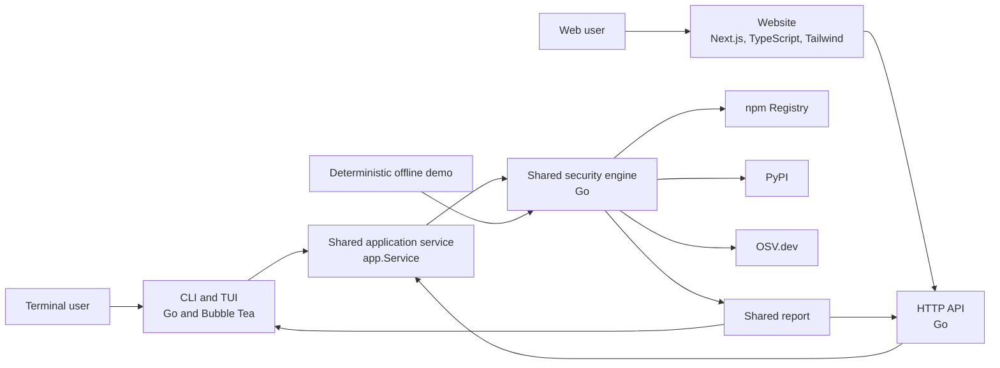

# DepScope Architecture

## 1. Status and scope

This document records the **approved architecture** for DepScope and the boundaries that future phases must preserve.

**Implementation status (2026-10-26):** Phases 1–7 are complete. The repository contains a working engine, live provider adapters, project dependency scanning, read-only global package inventory, terminal surfaces, an HTTP API, a website over the shared report contract, and local CI/release configuration:

- Go domain model for package identity, scan status, severity, findings, evidence, checks, dependency graph, sources, limitations, and the complete scan report.
- Canonical JSON Schema `1.0.0` for the report, embedded in Go and enforced by schema plus semantic validation.
- Live npm Registry, PyPI, and OSV.dev adapters behind the Phase 1 interfaces.
- Scan orchestrator with version selection, check assembly, deterministic ordering, and final-status derivation.
- Explainable risk rules, npm lifecycle-script inspection, and typosquat detection with a versioned reference dataset.
- Bounded cache, shared HTTP client, timeouts, bounded retries, body limits, and classified failures.
- Project scanning for npm `package-lock.json` v2/v3 graphs and exact-pinned Python `requirements.txt`, with dependency-path evidence and explicit unresolved-version reporting.
- Read-only global inventory of top-level npm global packages and the selected pip environment, with explained detection failures.
- A shared application service (`internal/app`) that the interactive and non-interactive terminal surfaces both consume.
- A report renderer (`internal/render`) with terminal sanitization, severity labels, dependency trees, comparison output, and optional color.
- A Bubble Tea interactive terminal application (`internal/tui`) with menu workflows, real progress, cancellation, separate report views, and settings.
- A non-interactive CLI (`internal/cli`) and binary (`cmd/depscope`) with deterministic exit codes and help fallback when no terminal is attached.
- An offline demo runtime (`internal/demo`) that reuses the shared engine with deterministic demo providers and fixed data.
- An HTTP API (`internal/api`, `cmd/depscope-api`) that validates requests, serves canonical reports and comparisons from `app.Service`, applies process-local limits and timeouts, and shuts down gracefully.
- A Next.js website (`web/`) that proxies live requests to the Go API, validates canonical reports, presents findings and comparisons, and keeps offline demo fixtures isolated from live mode.
- Deterministic, clearly labelled demo fixtures and tests, plus sanitized `httptest` provider tests, full-path engine integration tests, and synthetic project/inventory fixtures.

Coverage remains deliberately limited. npm project scans follow the lockfile graph but do not resolve workspaces or peer dependencies; Python project scans cover exact pins only and cannot resolve transitives; global inventory covers top-level npm packages and one pip environment. Project and inventory results are separate Go types built from the shared model and are not yet the v1 wire `ScanReport`, so neither API nor website exposes them. CI and tagged-release packaging are configured; public deployment does not exist. See `docs/contracts.md`, `docs/api.md`, `docs/risk-rules.md`, and `web/README.md` for implemented behavior.

The approved product scope is:

- A shared security engine written in Go.
- A terminal interface built with Bubble Tea.
- An HTTP API written in Go.
- A website built with Next.js, TypeScript, and Tailwind CSS.
- Initial security data sources: OSV.dev, the npm Registry, and PyPI.
- A shared report schema so terminal and website results stay consistent.
- npm and PyPI as the initial supported ecosystems.
- A deterministic, clearly labelled offline demo.

Items marked **open** are unresolved decisions listed in Section 11.

## 2. Design principles

1. **One engine, multiple surfaces.** All dependency analysis, vulnerability matching, and risk assessment live in the shared Go engine. The CLI/TUI and HTTP API are adapters; the website is a presentation client.
2. **One report contract.** Both terminal and web surfaces render the same versioned report. Neither surface may invent its own risk calculation or silently redefine fields.
3. **Explicit provenance.** Reports distinguish live data from offline demonstration data and identify which sources were consulted.
4. **Deterministic demonstration.** The offline demo must produce identical output across runs and must never be presented as live security data.
5. **Network isolation at the boundary.** Registry and OSV access is isolated behind source interfaces so the engine can be tested and demonstrated without network access.
6. **Phase discipline.** Each phase requires explicit approval and must not absorb work assigned to later phases.

## 3. System context



The website does not call npm, PyPI, or OSV directly in the initial scope. Doing so would duplicate engine logic, complicate rate-limit handling, and allow presentation results to diverge from terminal results.

## 4. Components and responsibilities

### 4.1 Shared security engine (Go)

The engine is a library, not a process. It owns:

- The scan request and result domain model.
- Dependency resolution for npm and PyPI within the agreed scan semantics.
- Package identity normalization across ecosystems.
- Vulnerability lookup through OSV.dev.
- Matching resolved package versions to advisories.
- Severity normalization, risk assessment, and explanations.
- Report assembly and schema-version stamping.
- Source provenance and data-freshness metadata.
- Progress reporting through an interface consumable by both the CLI/TUI and the API.

The engine does **not** parse command-line flags, render terminal views, serve HTTP, or contain web presentation logic.

**Project boundary (Phases 1–6):** packages are scanned through the engine. Phase 3 moved local project parsing into the engine layer: `internal/project` detects supported manifests and lockfiles, builds the project graph, and batches packages through the scanner. The Phase 4 CLI/TUI pass a project root or installed-inventory request through `app.Service` and render the returned result; they do not implement their own local parsing or dependency resolution. The Phase 5 API follows the same boundary: it calls `app.Service` for package scans and comparisons and does not expose project or inventory results. The Phase 6 website consumes canonical reports through its server-side proxy.

**Phase 2 implementation:** `internal/engine/scanner.go` orchestrates the live providers. `internal/sources/npm`, `internal/sources/pypi`, and `internal/sources/osv` implement the source interfaces. `internal/fetch` provides the shared JSON client, and `internal/cache` provides a bounded TTL cache. `internal/live` wires the default providers together. Risk and evidence rules are normative in `docs/risk-rules.md`.

**Phase 3 implementation:** two read-only scanners sit on top of the engine scanner.

- `internal/project` inspects fixed filenames in a project root, parses a supported lockfile or pinned requirements file, builds a project-rooted dependency graph, and batches resolved packages through the engine. It does not recurse into `node_modules`, vendor directories, or build outputs, and it does not follow symlinks. Findings carry dependency-path evidence.
- `internal/inventory` lists installed packages using read-only package-manager mechanisms (`npm root -g` plus installed metadata, and `pip list --format=json`), then matches installed identities and versions through the same engine. It never imports, installs, upgrades, or executes a package.

Both packages expose their own `Result` types assembled from shared model types. They are part of the engine boundary and must not be reimplemented in CLI/TUI or API adapters. Turning them into a versioned wire report is an open decision (D16).

### 4.2 CLI and TUI (Go + Bubble Tea)

The terminal surface owns:

- Command parsing, global flags, usage output, and process exit codes.
- Selection of package, project, comparison, inventory, or demo workflows.
- Non-interactive plain-text output for scripts and automation.
- Interactive Bubble Tea screens, menu navigation, forms, cancellation, and report exploration.
- Terminal-safe rendering of all remote advisory text.
- Deciding whether a terminal is available before starting the interactive menu.

It delegates project parsing, dependency resolution, vulnerability matching, risk assessment, inventory listing, demo data construction, and result assembly to the engine. It must not embed registry or OSV client logic, parse lockfiles, or maintain a second package inventory implementation.

**Phase 4 implementation:**

- `internal/app` defines `Service`, the shared scanning contract used by both terminal surfaces. `LiveService` wires the live scanner, project scanner, inventory scanner, and offline demo. TUI and CLI call this service and never construct engine requests directly.
- `internal/cli` parses global flags and commands, renders documents, maps statuses to exit codes, and falls back to help when input or output is not a terminal. It does not contain scan logic.
- `internal/tui` is a Bubble Tea `tea.Model`. Scans run in commands that call `app.Service`; real `app.Progress` callbacks are forwarded as messages. Each scan has a cancellable context, and results or progress from cancelled or superseded scans are ignored. The state machine is tested without a terminal.
- `internal/render` turns shared report, project, and inventory results into `Document` values and plain text or limited ANSI output. It sanitizes untrusted text on copies of the input and never recalculates risk.
- `cmd/depscope` wires standard streams, terminal detection, signal handling, and the CLI exit code.

The implemented command surface is `scan`, `project`, `compare`, `inventory`, `demo`, `help`, and `version`, with global color flags. Command names and flags are now fixed for this phase; adding machine-readable output remains open (D14).

### 4.3 HTTP API (Go)

The API is a thin transport adapter that:

- Validates and limits incoming requests.
- Maps requests to `app.Service` calls, which in turn use engine scan requests.
- Serializes reports using the shared schema and validates each report through `internal/contract` before returning it.
- Returns stable, documented error responses.

It does not contain a second implementation of scanning or risk logic, and it does not accept arbitrary fetch URLs. The Phase 5 scope implements `GET /healthz`, `POST /api/v1/scan`, and `POST /api/v1/compare`, exact-origin CORS, request-size and field validation, per-request timeouts, capped concurrency, process-local per-client rate limiting, panic containment, and graceful shutdown. Authentication, authorization, horizontal rate-limit coordination, and deployment topology remain open. The endpoint and limit contract is documented in `docs/api.md`.

### 4.4 Website (Next.js + TypeScript + Tailwind CSS)

The website owns:

- Report presentation, explanation, filtering, and navigation.
- Client-side and/or server-side data fetching from the API.
- TypeScript types aligned with the shared report schema.
- Accessible, responsive presentation.
- Clear visual labelling of offline demonstration data.

The website must not independently query npm, PyPI, or OSV, and must not recompute risk in a way that could disagree with the engine. Whether the site is statically rendered, server-rendered, or client-rendered is open.

Dependency graph and comparison features are referenced as future capabilities but are not specified in this phase.

### 4.5 Shared report contract

The report is the primary integration contract between surfaces. It is:

- Versioned (`1.0.0` in the current schema).
- Language-neutral in intent, serialized as JSON.
- Stable enough to render without surface-specific business logic.
- Explicit about provenance, timestamps, and live versus demonstration data.

**Resolved in Phase 1:** `schemas/scan-report.v1.schema.json` (JSON Schema 2020-12) is the single source of truth. Go types in `internal/model` mirror the schema, and `internal/contract` validates both raw JSON and Go structs against the embedded schema before applying semantic cross-field checks. Website TypeScript types are generated from the same schema and checked against the canonical copy.

The schema enforces `additionalProperties: false`, camelCase field names, a closed set of statuses and severities, and the invariants that prevent a missing result from becoming clean. Details are in `docs/contracts.md`.

### 4.6 Offline demo

The offline demo is a first-class requirement, not a mock hidden behind a development flag. It must:

- Use deterministic fixtures with fixed package versions, advisories, and timestamps.
- Avoid live network calls.
- Reuse the same report contract and, where practical, the same engine code path as live scans.
- Be clearly labelled in every surface that displays it.
- Remain reproducible in tests and in environments without network access.

**Implemented in Phase 4:** `internal/demo` builds a real `engine.Scanner` with demo providers, a fixed clock, and the shared risk evaluator. Three code-defined scenarios cover known vulnerabilities, install-script warnings with a deprecation signal, and a no-findings release. Every report uses `dataMode: "demo"`, the shared demo notice, `provider: "demo"` sources, synthetic package names, and `DEMO-` advisory identifiers. The scenario data is code, not recorded live responses. The demo runtime is activated by `depscope demo [scenario]`, `depscope demo list`, or the TUI demo picker; live and demo modes are separated at scanner construction and request validation, so fixture results cannot enter a live scan.

## 5. Dependency and boundary rules

The intended dependency direction is:

```text
cmd/depscope ─> cli ─┬─> tui ─┐
                     └────────┴─> app.Service ─> engine ─> source adapters (npm, PyPI, OSV)
                                          │          └─> demo providers (offline)
                                          ├─> project
                                          └─> inventory
cmd/depscope-api ─> api ─> app.Service
cli / tui ─> render ─> shared report model
api ─> contract ─> schemas
Website ─> HTTP API ─> app.Service ─> shared engine
```

Rules:

1. The engine must not import CLI, TUI, app, render, API, or HTTP packages.
2. The API must not depend on TUI or CLI packages, and it must obtain scans through `app.Service` rather than constructing engine requests itself.
3. The website must not call external security sources directly in the initial scope.
4. Renderers consume reports; they do not mutate findings or recalculate risk. Sanitization happens on copies.
5. Source adapters must be replaceable with deterministic fixtures.
6. The schema contract must be consumable by both Go and TypeScript without manual reinterpretation.
7. Project scanning and global inventory belong to the engine layer; surfaces must not reimplement local parsing, graph construction, or inventory detection.
8. Local scanning must not execute project code, package code, lifecycle scripts, or package-manager installation commands, and it must not read arbitrary filesystem paths or follow symlinks outside the intended project root.
9. Inventory must use documented read-only listing mechanisms and installed metadata, and must explain detection failures instead of returning an empty success.
10. The CLI and TUI must obtain all scan results through `app.Service`; they must not access registry, OSV, project, or inventory packages directly.
11. The offline demo must run through the shared engine with demo providers and must never share a scanner or data path with live mode.
12. The API must reject unknown fields, oversized bodies, non-JSON media types, and URL-shaped package names or versions before calling `app.Service`. It must return canonical reports validated through `internal/contract`, never a second report model, and must not cache complete responses in a way that could replay an unavailable check as a success.
13. API limits and CORS policy are process-local unless a later deployment decision introduces a shared enforcement layer.

## 6. Data sources

| Source | Intended use | Phase 2 implementation |
| --- | --- | --- |
| OSV.dev | Vulnerability advisories and affected version ranges | `POST /v1/query` by package identity and resolved version; severity, aliases, ranges, fixes, and references normalized. |
| npm Registry | Package metadata and dependency information | Package document at `/@scope%2Fpkg` or `/<name>`; dist-tags, versions, dependencies, optional dependencies, lifecycle scripts, deprecation, repository, and publication times. |
| PyPI | Project and release metadata, including dependency metadata where available | Project and version JSON documents; `requires_dist`, upload times, project URLs, yanked status, and PEP 503 name normalization. |

**Assumptions to confirm:**

- Initial access uses only public, unauthenticated endpoints.
- No credentials or private registries are required for npm or PyPI.
- Only package identifiers and versions are transmitted; no source code is uploaded.
- Network access from the development environment to all three services is required for live mode. It was **not** verified in Phases 0–2; all tests use local `httptest` servers.

Each adapter defines timeouts, retry/backoff behavior, caching, and explicit failure results. Live failure never silently falls back to stale or demo data.

## 7. Report content

The schema is implemented; `schemas/scan-report.v1.schema.json` is normative and `docs/contracts.md` describes the model. A report answers:

- What was scanned, in which ecosystem, and in which mode (live or offline demo)?
- Which packages and versions were resolved, and how each was introduced?
- Which advisories affect them, with identifiers, aliases, severity, and references?
- What risk was assigned, and why?
- Which checks ran, and did any of them fail, get skipped, or become unavailable?
- Which sources were consulted, when, and did any of them fail?
- What limitations apply to the result?
- What schema version is being used?

Conceptual groups:

| Group | Purpose |
| --- | --- |
| Report metadata | Schema version, generation time, mode, and scan target |
| Summary | Counts and highest-level risk signals |
| Findings | Package identity, dependency path, advisories, severity, remediation data, and risk rationale |
| Checks | Per-check outcome, status, message, and source references |
| Dependencies | Root node and resolved dependency graph |
| Provenance | Sources, retrieval timestamps, partial-failure flags, and demo-data marker |
| Limitations | Explicit caveats that prevent overstating confidence |

Untrusted advisory text and package metadata must be escaped for both terminal output and HTML rendering.

## 8. Security, privacy, and trust

- Treat all registry and OSV responses as untrusted input.
- Treat project manifests, lockfiles, requirements files, and installed package metadata as untrusted input.
- Sanitize remote text before terminal rendering to prevent terminal escape-sequence injection.
- Escape remote text before web rendering to prevent cross-site scripting.
- Do not commit credentials or tokens. No credentials are expected for the initial public-data scope.
- Do not upload source code or local file contents; transmit only the metadata required for lookups.
- Do not fetch arbitrary remote URLs found in manifests or requirements files.
- Do not follow symlinks outside the intended project root or read arbitrary filesystem paths without a documented reason.
- Verify and document each source's terms, rate limits, and required client identification before live integration.
- Keep dependency versions pinned and review third-party additions, since DepScope is itself a supply-chain tool.
- No telemetry or analytics is planned unless explicitly approved.

## 9. Failure and determinism requirements

- A source failure must produce a visible partial or failed result, not a silent success.
- A missing, unavailable, skipped, or failed check must never produce a `clean` report. This is enforced in both the JSON Schema and the Go semantic validator.
- Unsupported formats, missing lockfiles, unresolved versions, malformed local metadata, and detection failures must be reported explicitly. They must never be approximated with latest-version data, skipped silently, or presented as an empty success.
- Project and inventory scans must be deterministic for identical local input, including sorted packages, findings, checks, sources, and limitations.
- Local scanning must be bounded in file count, file size, graph nodes, dependency depth, included files, package count, and package-manager output size.
- Offline demo output must be byte-for-byte stable for identical inputs, including timestamps and ordering.
- Terminal output must be deterministic for identical reports and theme settings. Color-disabled output must contain no ANSI escape sequences, and `NO_COLOR` or `TERM=dumb` must disable color regardless of the requested mode.
- Interactive progress must reflect real work reported by the engine. The interface must not fabricate progress percentages or insert artificial delays.
- Cancelling a scan must cancel its context, and results from cancelled or superseded scans must not be displayed.
- Ordering of findings and dependencies must be deterministic in demo mode and stable in live mode.
- Risk explanations must be reproducible from report data; surfaces must not add undisclosed heuristics.

## 10. Out of scope for the initial architecture

The following are not approved for the initial implementation and require separate decisions:

- Ecosystems other than npm and PyPI.
- Private registries or authenticated package sources.
- User accounts, stored scan history, or multi-tenant persistence.
- Public deployment infrastructure and hosted service operation.
- Telemetry, analytics, and crash reporting.
- A finalized risk-scoring methodology, dependency-graph specification, or comparison-feature specification.

## 11. Open decisions

Status reflects the Phase 8 final integration review (2026-10-26). "Resolved" means the decision is recorded and enforced by the current contracts; "Partial" means only the implemented slice is fixed.

| ID | Decision | Status and impact |
| --- | --- | --- |
| D1 | Initialize Git; choose default branch and remote repository URL | **Partial.** Phases 0–8 are committed locally on `feature/phase-6-website`. No remote URL or default branch is configured; none is inferred. |
| D2 | Choose an open-source license | **Resolved by the maintainer.** Apache License 2.0 is applied, with `Copyright 2026 Jangho Tan` in `LICENSE` and `NOTICE`; all other license terms are unmodified. `NOTICE` lists the third-party licenses. |
| D3 | Choose the Go module path | **Selected for repository preparation.** `go.mod` uses `github.com/janghotan/depscope`, derived from the authenticated GitHub account and the intended repository name. Revisit if the owner, name, or hosting changes before publication. |
| D4 | Choose the JavaScript package manager and Next.js, Tailwind CSS, and Node version policy | **Resolved for Phase 6.** The website uses pnpm 12.14.0, Node 24, Next.js 16.4.3, and Tailwind CSS 4.3.3. Exact dependency versions and package manager policy are declared in `web/package.json` and `web/pnpm-lock.yaml`. |
| D5 | Choose the minimum Go version and supported operating systems/architectures | **Resolved for Phase 7 builds.** Go 1.26.10 is the validated minimum; binary targets are Linux, macOS, and Windows on amd64 and arm64. CI cross-compiles these targets; runtime support has not been tested on every platform. |
| D6 | Confirm the repository layout and whether Go and web code share one repository root | **Partial.** Go code lives under `internal/`, the schema under `schemas/`, fixtures under `testdata/`, and the Next.js application under `web/` in the same repository. Final layout remains revisitable. |
| D7 | Choose the report schema source of truth and type-generation/contract-test strategy | **Resolved.** `schemas/scan-report.v1.schema.json` is canonical; Go mirrors it; TypeScript must be generated from it. Contract tests enforce alignment. |
| D8 | Define scan semantics: manifest vs lockfile vs installed environment, dependency depth, development dependencies, and version resolution | **Partial.** Phase 2 resolves one target package. Phase 3 adds npm project graphs from `package-lock.json` v2/v3 and direct Python dependencies from exact-pinned `requirements.txt`, plus read-only installed inventory. npm workspaces, peer dependencies, Python transitive resolution, other lockfile formats, development-dependency policy, and broader installed-environment scanning remain open. Unsupported or unresolved input always yields `incomplete`, never `clean`. |
| D9 | Define severity normalization and risk scoring | **Resolved for Phase 2.** Severity enum, confirmed/heuristic separation, and deterministic prioritization rules are documented in `docs/risk-rules.md`. A validated probabilistic maliciousness model is explicitly not claimed. |
| D10 | Define API endpoints, authentication, CORS, rate limits, and request size limits | **Partial.** Phase 5 fixes `GET /healthz`, `POST /api/v1/scan`, and `POST /api/v1/compare`; strict field validation; body, concurrency, timeout, and per-client rate limits; exact-origin CORS; and the stable error envelope in `docs/api.md`. Authentication, authorization, trusted-proxy handling, shared multi-instance limits, and deployment topology remain open. |
| D11 | Decide offline demo placement and activation | **Resolved.** Go demo scenarios live in `internal/demo` and use deterministic demo providers; website examples use validated synthetic report fixtures, are labelled on every surface, and make no scan or comparison API requests. The shared site header may check local API health. Live and demo data paths stay separate. |
| D12 | Define caching, timeout, retry, and partial-failure policy | **Resolved for Phase 2.** Bounded TTL cache, provider and scan timeouts, bounded `429`/`5xx` retries with capped `Retry-After`, body limits, and visible partial failures are implemented and documented in `docs/contracts.md`. Source-specific tuning may follow live verification. |
| D13 | Choose hosting/deployment targets | **Open.** No public website or API deployment is configured or implied by release artifacts. |
| D14 | Decide whether the CLI emits machine-readable JSON in addition to human-readable output | **Open.** Phase 4 implements human-readable text only. The command surface and exit codes are fixed, but no JSON mode or schema for command envelopes exists. |
| D15 | Specify dependency graph and comparison features | **Partial.** The website renders the report dependency graph as a keyboard-operable textual tree with direct/transitive relationships, vulnerable-path markers, and node details. Website comparison consumes the documented API envelope and preserves independent side failures. Project scan wire representation remains unspecified. |
| D16 | Choose how project and global-inventory results integrate with the report contract | **Open.** `internal/project` and `internal/inventory` return separate Go result types built from shared model types. The v1 `ScanReport` requires exactly one target package, so these results are not yet schema-valid reports. The terminal renders them through the shared `Document` model. Phase 5 deliberately does not expose them through the HTTP API; the website must not expose hand-built JSON before this is decided. |
